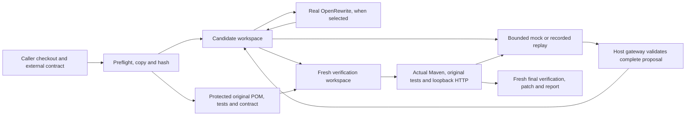

# Architecture and contribution

This is a Java 17 harness for one historical, unsupported Spring Boot migration: 2.7.18 to 3.0.13. It accepts trusted fixture-compatible Maven code and an external HTTP contract. The caller's checkout is copied, rather than edited. `Main` selects recipes-only, agent-only or hybrid; `Engine` records provenance and controls the run.

The core recipe pack changes the exact parent version, Jakarta validation/servlet package references and selected header property. It intentionally does not choose application routing policy. Spring Framework 6's trailing-slash behavior makes `/greeting/` fail in the MVC fixture after that mechanical migration. The scripted mock recognizes that specific protected failure and proposes an explicit route. Agent-only uses the same narrow mechanical mock plus route policy; it executes no recipe. The mechanical fixture already has the explicit route, so recipes suffice. The unresolved contract also checks POST `/greeting/`; the mock declines its unsupported diagnostics.

## Editing and verification authority

`EditingAgent.Gateway` lists/reads permitted candidate files and validates proposals. Existing main Java files are editable. `application.properties` permits only the forward selected header-key rename. `pom.xml` permits only the byte-exact forward parent-version edit. It rejects tests, contracts, build configuration, plugin/dependency additions, file additions/deletions, noncanonical paths, links and Windows path bypasses. Every edit's preimage is checked before any staging; all files are staged, checked again, then replaced per file with atomic moves. A commit error rolls completed writes back. This is a single-writer host protocol, not an atomic filesystem-wide view for concurrent readers.

`Verifier` owns the original POM/test/contract copies outside the candidate. It excludes candidate tests, copies the preserved tests, and writes a host-approved source/target POM into each new verification tree. Maven `clean verify` runs with skip flags false and a 2 GiB test-fork heap cap. Successful stages require actual Surefire execution. An application child binds loopback on a fresh port; host HTTP checks preserve status/body expectations. The final stage rematerializes and rebuilds again. A prior pass is never a substitute for final verification; exhausted infrastructure, policy or interruption paths stop with their available evidence.

`Processes` passes argv without shell concatenation, removes Maven/Java option-injection environment variables, drains output after its 1 MiB retained limit, and kills captured descendants/parents on timeout or interruption. `RunBudget` supplies remaining time to subprocesses and HTTP checks. One Maven-heavy child or application child runs at a time. The controller checks deadlines around cooperative in-process mock calls; arbitrary blocking Java agent code cannot be forcibly preempted here. Graceful JVM shutdown attempts cleanup/reporting. OS force-kill cannot guarantee either.

## What this adds

[OpenRewrite](https://docs.openrewrite.org/reference/rewrite-maven-plugin) supplies the transformation engine. [Spring Boot Migrator](https://github.com/spring-projects-experimental/spring-boot-migrator) already provides a Spring migration CLI. [SWE-agent](https://github.com/SWE-agent/SWE-agent) already demonstrates editing-agent harnesses. This project adds a small inspectable Java experiment around those ideas: one captured snapshot across modes, narrower editing authority than verification authority, explicit stopping reasons, and evidence joining proposals to actual verification. It makes no first-migrator, novel-agent, LLM superiority or general compatibility claim.

Mock knowledge is deliberately narrow and visible in `EditingAgent.MockAgent`. All reported builds, recipe runs and HTTP observations are real; proposals are scripted or replayed. A copied workspace is not an OS sandbox for malicious Java, Maven plugins or a hostile agent. Passing six or seven fixture checks is scoped behavior evidence. No current supported-release target, arbitrary Spring/Security/JPA/Cloud migration, model provider, hosted app or paid service is implemented.

Implementation map: `Main`/`Engine` orchestrate; `Trees`/`PomPolicy` guard snapshots/build surface; `EditingAgent` grants capabilities; `RepairController` stops attempts; `Transcript` binds replay; `Verifier` tests fresh candidates; `Processes`/`RunBudget` bound tools; `Json` serializes reports. Delivery scripts inspect these outputs and never acquire editing-agent authority. See [contracts](CONTRACTS.md), [CI](CI.md) and [dependency attribution](../DEPENDENCIES.md).
